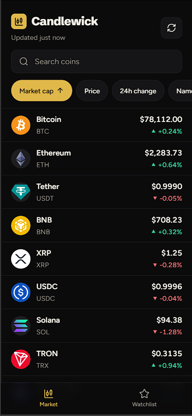
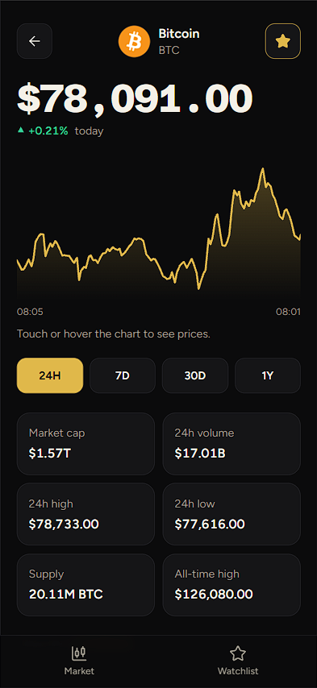
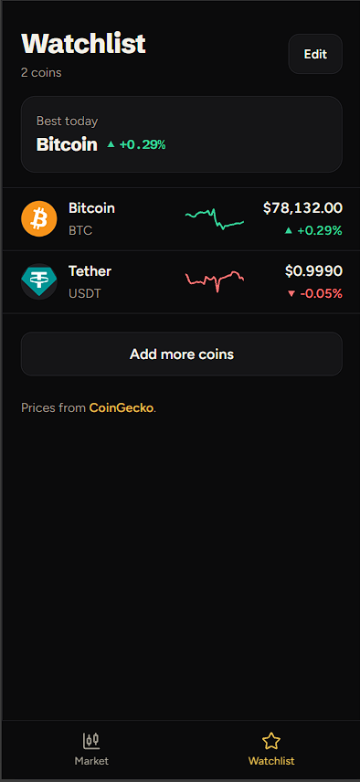

# Candlewick

A crypto price tracker. Search the top 100 coins, sort the list, open a coin to read its chart and stats, and keep a watchlist.
Built with React, TypeScript, Vite and Tailwind CSS.

<p>
  
  
  
</p>

## What it does

- **Market:** live prices for the top 100 coins, refreshed every minute. Search by name or symbol, and sort by market cap, price, 24 hour change or name. Tap a sort again to flip it.
- **Coin page:** the current price and today's move, a price chart with 24H, 7D, 30D and 1Y ranges, and six stats (market cap, volume, 24h high and low, supply, all-time high).
- **Watchlist:** star a coin to keep it. Each coin shows a 7 day trend line. Your list is saved in the browser and syncs between tabs.
- **Real-world states:** loading placeholders, a friendly message for every kind of failure (no connection, too many requests, a bad reply, a coin that does not exist), and the last prices stay on screen if a refresh fails.

## Built with

- [React 19](https://react.dev) and [TypeScript](https://www.typescriptlang.org)
- [Vite](https://vite.dev) and [Vitest](https://vitest.dev)
- [Tailwind CSS v4](https://tailwindcss.com), with a black and gold theme made from CSS variables
- [TanStack Query](https://tanstack.com/query) for fetching, caching and refreshing data
- [React Router](https://reactrouter.com) and [lucide-react](https://lucide.dev)
- Prices from the free [CoinGecko API](https://www.coingecko.com/en/api). No account or key is needed.

## Run it

You need [Node.js](https://nodejs.org) 20.19 or newer (or 22.12 or newer).

```bash
npm install
npm run dev
```

Then open the address Vite prints, usually http://localhost:5173.

```bash
npm test          # run the tests
npm run lint      # check the code
npm run build     # type-check and make a production build in dist/
```

The free price service allows only a limited number of requests per minute. If you see "Too many requests", wait a minute and try again.

## How the code is organised

```
src/
  api/          Calls to the price service, and the errors they can return
  components/   Screen parts: coin rows, chart, range buttons, star button, error state
  hooks/        Data (useMarkets, useCoinData, useWatchlistCoins), the saved watchlist, small helpers
  lib/          Pure logic: search and sort, chart maths, number formatting, watchlist rules
  pages/        Market, Coin, Watchlist, NotFound
```

A few choices worth knowing about:

- **Logic lives in small pure functions** (`lib/`), so it is easy to test. There are 54 tests covering search and sort, turning API replies into coins, the chart maths, number formatting, the saved watchlist and every error case.
- **The chart is drawn by hand with SVG**, with no chart library. You can read it with a finger, a mouse or the arrow keys, and a screen reader gets a plain-words summary.
- **Failures are expected.** Every request turns problems into a typed `ApiError`, and each screen shows the right message. Bad items in a reply are skipped instead of crashing the page.
- **The watchlist uses one shared store** read with `useSyncExternalStore`, so every screen agrees and other tabs update too. Corrupted saved data is cleaned instead of breaking the app.
- **Accessible by default:** labelled controls, a skip link, visible focus, price moves shown with an arrow and a sign as well as colour, and reduced-motion support.

## Putting it online

It is a static single-page app. `vercel.json` and `public/_redirects` make page refreshes work on Vercel and Netlify.

## About

Designed and built by [Joel Ezuzu](https://github.com/Joel-Ezuzu).
